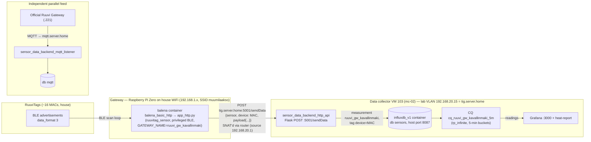

# ble-gateway

Raspberry pi gateway for BLE sensors. Work in progress.

Two data paths are supported, chosen by the entrypoint of the container:

* **InfluxDB-direct** (`app.py`): the container holds Influx credentials and writes records itself. This is what master has always done.
* **HTTP backend** (`app_http.py`, this branch): the container is storage-agnostic — it just decodes RuuviTag data and POSTs it as JSON to a separate `sensor_data_backend` service, which owns the database writes. This is the layout used for the balena fleet and the `balena_basic_http` variant below.

## Status

* runs locally on debian stretch, Python 3.5, built-in bluetooth
* run in debian stretch based Python 3.5. docker container (some magic required to start, see bottom)
* runs together with balena wifi connect (see `balena_wificonnect` directory)
* testing git hooks

## TODO / next steps

* check out ~/code/cloned/ruuvitag/sensor for a very minimalistic MQTT based solution (the other containers might not be needed)
* use environment variables or a JSON config to pass all sensitive information. Would also make changing endpoints easy.


# Howto

Uses libarary:

https://pypi.org/project/ruuvitag_sensor/


## Local development

### Install required packages

OS level packages:
```` bash
sudo apt-get install bluez bluez-hcidump
````

Python environment:
```` bash
sudo apt install python3-venv
python3 -m venv venv
source venv/bin/activate

python3 -m pip install wheel ruuvitag_sensor
````


### To run the examples

```` bash
sudo ../venv/bin/python3 ruuvi_app_multitag.py  
````

BLE tools require sudo. Explicit reference to venv's python executable is needed for running the code with sudo privileges.


## Local development with Docker

Files under app/ need to be copied to the same directory as the Dockerfile for the docker build to work. Master versions of the files reside in app/.

### Step 1

Check the [./docker_debian/config.py](./docker_debian/config.py) contents and modify if needed.

### Step 2

Run these to test or deploy:

```` bash
cp app/*.* docker_debian/app
docker compose build
docker compose up -d
````
This is the recommended way as the `docker-compose.yml` e.g. sets logging such that the log files will not grow without limit.

To run without docker compose:
```` bash
cp app/*.* docker_debian/app
cd docker_debian

docker build -t gwtest .
sudo docker run -d --net=host --privileged -i -t gwtest

docker build -t ble-gateway .
sudo docker run -d --restart=always --net=host --privileged -i -t ble-gateway

````


Other docker commands that might be of help in some environments:
```` bash
sudo docker run --cap-add=SYS_ADMIN -v /opt/bluetooth:/var/lib/bluetooth -v /sys/fs/cgroup:/sys/fs/cgroup:ro -v /tmp/$(mktemp -d):/run --net=host --privileged -i -t gwtest /bin/bash

sudo docker run --net=host --privileged -i -t gwtest /bin/bash
````


## Deploy to balena device

Install balena command line tool. Then:

```` bash
balena login
cp app/*.* balena_basic_http/app
cd balena_basic_http
balena push BLE-gateway-test --noparent-check
````

```` bash
balena login
mkdir balena_basic/
cp app/*.* balena_basic/app
cp app/config_prod.py balena_basic/app/config.py
cd balena_basic
balena push BLE-gateway-test
````

```` bash
balena login

cp app/*.* docker_debian/
cd docker_debian
balena push BLE-gateway
````

The Dockerfile should be named `Dockerfile.template`: otherwise balena push command doesn't fetch the base image correctly.
Files under `balena_wificonnect` are copies from `app` as files to copy need to be in the same directory structure as the Dockerfile and symlinks do not work (?).

# Deployment variants (what lives in each subfolder)

The shared source of truth is `app/`. Before building a container, the master
versions are copied into the variant's `app/` directory (they are not tracked
in git for the variants below — except in `balena_basic_http`, where they were
committed as a snapshot):

| Folder | Variant | Entrypoint | Data write path |
|---|---|---|---|
| `app/` | Source of truth + bare-metal use (`ruuvi_app_multitag.py` etc. run under `sudo` for BLE access) | — | InfluxDB-direct via `app.py` |
| `docker_debian/` | Generic Debian docker container for any Linux host. Ships its own `docker-compose.yml` (host networking + privileged, log rotation caps) | `app.py` | InfluxDB-direct; host/port/database in `config.py` |
| `balena_basic/` | Minimal balena fleet layout (`Dockerfile.template`, only the balenalib base) | `app.py` | InfluxDB-direct |
| `balena_wificonnect/` | balena fleet layout + `start.sh` running WiFi provisioning (bluetooth-free wifi setup) before starting the app | `app.py` | InfluxDB-direct |
| `balena_basic_http/` | balena fleet layout for the HTTP-backend architecture. `app_http.py` + `sensor_data_reporter.py` are copied in; config comes from env vars, not files | `app_http.py` | HTTP POST to `sensor_data_backend` |

Note that in all Influx variants the credentials/host live in `config.py`
(copied from `config_prod.py`), while in the HTTP variant `app_http.py` reads
them from environment variables instead: `SENSOR_DATA_HOST`, `SENSOR_DATA_PORT`
and `GATEWAY_NAME`.

# Architecture of the HTTP variant



## What the backend does on receipt

The receiving API is the `http_api` service of the separate repo
`mqtt_sensor_data_backend` (GitLab: `jussitapiokorpela/mqtt_sensor_data_backend`,
running in production on VM 103 as container `sensor_data_backend_http_api`).
It is a thin Flask endpoint:

1. Receives `{"sensor": "<gateway name>", "device": "<tag MAC>", "payload": {...}}`.
2. Validates the payload (`shared_utils.sensor_records`).
3. Writes it to the InfluxDB v1 instance inside the same docker network
   (database from its `.env`, in production `sensors`), using the `sensor`
   field as the measurement name and `device` as a tag.
4. A continuous query (`cq_ruuvi_gw_kavallinmaki_5m`) aggregates raw
   `ruuvi_gw_kavallinmaki` points into 5-minute buckets in the `rp_infinite`
   retention policy — those buckets are what Grafana dashboards and the
   `heat-report` service read as room/outdoor temperatures.

So the gateway's only job is *decode BLE → wrap JSON → POST*. All knowledge of
which database, retention policy or naming convention is used lives behind the
HTTP endpoint, and swapping the storage backend does not require touching the
gateway image.

## Probable balena deployment flow (HTTP variant)

1. `balena login` (opens a browser session against balenaCloud).
2. Copy the source files into the fleet build directory:
   ```bash
   cp app/*.* balena_basic_http/app
   cd balena_basic_http
   ```
3. Set the fleet environment variables in balenaCloud (dashboard → BLE-gateway-test
   fleet → Environment variables):
   * `SENSOR_DATA_HOST=tig.server.home`
   * `SENSOR_DATA_PORT=5001`
   * `GATEWAY_NAME=ruuvi_gw_kavallinmaki`
4. Build and release from the build directory:
   ```bash
   balena push BLE-gateway-test --noparent-check
   ```
   `Dockerfile.template` is rendered per-device-type by the balena builders
   (`%%BALENA_MACHINE_NAME%%` becomes e.g. `raspberry-pi`), the image is built
   in balenaCloud, and a release is created.
5. The device supervisor on the Raspberry Pi Zero downloads the release, starts
   the privileged container with the fleet environment injected, and `app_http.py`
   binds the built-in Bluetooth and starts the scan loop (`RuuviTagSensor.get_data`).
6. Every received tag decode within `MIN_REPORT_INTERVAL_SEC` is POSTed to the
   backend; nothing is stored on the gateway itself.

Live behaviour observed in the homelab: the Zero (named "raspi zero ruuvi gw"
in the receiver docs) POSTs roughly every minute (~160k points/day across 16
MACs). Note the gateway sits on the house WiFi (192.168.1.x), so from the lab
VLAN only the router (192.168.20.1) is involved — traffic arrives SNAT'd and
the device itself is not probeable from the lab network. For homelab
debugging of this series (`sensors/ruuvi_gw_kavallinmaki`), see the
`data-flow-debug-playbook` / `data-flow-monitor` notes in the homelab wiki.

# Changelog

2026-10-24 Added architecture docs: HTTP-backend variant, subfolder variants, mermaid data flow to InfluxDB, and the balena deployment flow (branch feature/changes-from-2023)
2022-09-11 Added three new ruuvi tag mac addresses
2021-06-19 Upgraded balena wifi-connect. Now using debian from balena container images as the base. Balena python example was outdated.
2021-01-23 Changed to python:3.8-buster in Dockerfile due to pip install problems. Improved pip installation commands as well.